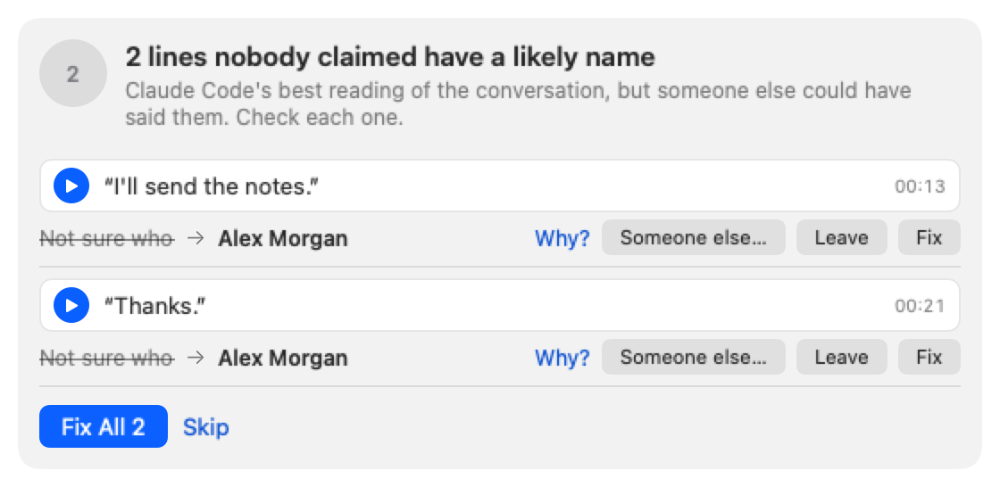
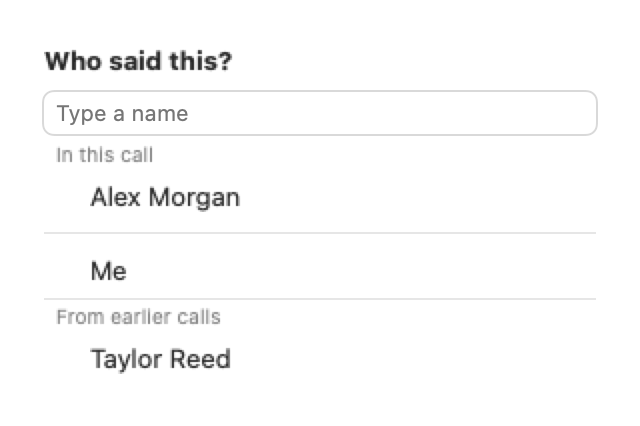
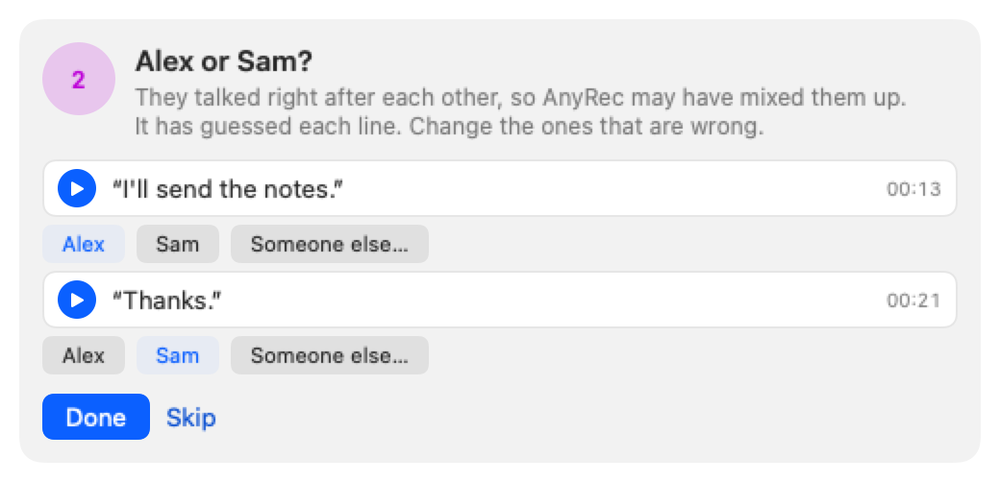
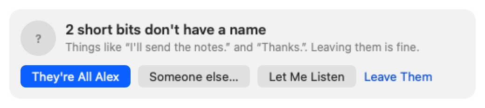
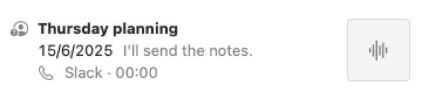

# People in this call

[Proposals](Proposals.md) · [Editable SwiftUI artboards](../Tests/AnyRecBarTests/Artboards/PeopleReviewArtboards.swift)

## Suggested names

## Someone else

## Mixed voice

## Unclaimed lines

## Unnamed Voices

Render these views from the repository root with
`ANYREC_ARTBOARDS="$PWD/design" swift test --filter PeopleReviewArtboards`.
