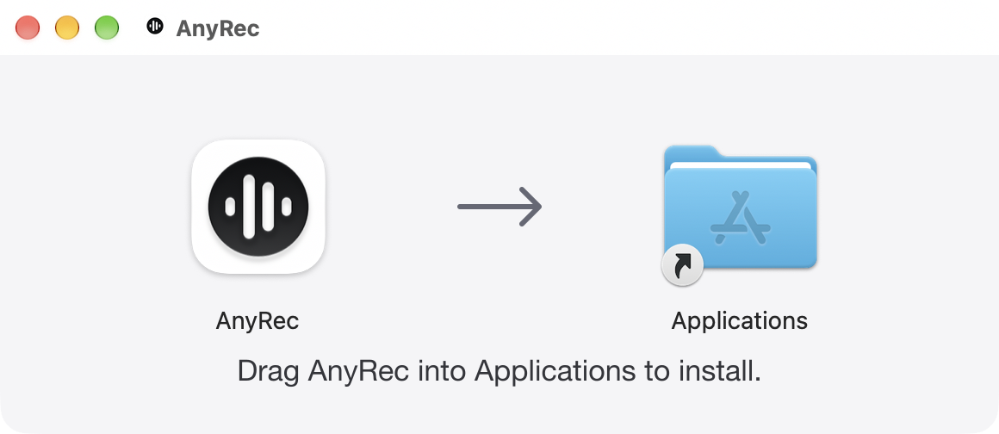

# Website call scenes

[Proposals](Proposals.md) · [Page layout](../website/index.html) · [Capture guide](../website/CAPTURE.md)

## Website and Mac identity

The navigation and social card use the [Dual Track Cutout wordmark](../website/assets/dual-track-wordmark.svg). The [Mac icon](../Resources/AppIcon.svg) appears in Finder, the Dock, and the website download section.

## Before the call

The [recording reminder](../Sources/AnyRecBar/CallReminder.swift) floats in its own borderless panel above the [staged call window](../Sources/AnyRecBar/WebsiteDemo/DemoCall.swift).

## During the call

The timer shares the Mac menu bar with Wi-Fi and the system clock. The [menu-bar panel](../Sources/AnyRecBar/StatusPanelPresentation.swift) opens directly beneath it with the [recording controls](../Sources/AnyRecBar/Views/RecordingPanel.swift).

## Mac installer

The [Finder layout](../Resources/Installer/layout.py) places AnyRec on the left and Applications on the right, over the [editable background](../Resources/Installer/background.svg).

## After the call

The [Transcription settings screenshot](../website/assets/transcription-settings.jpg) shows the engine controls.

The [sample transcript](../Sources/AnyRecBar/WebsiteDemo/DemoTranscript.swift) opens the same [speaker picker](../Sources/AnyRecBar/Views/SpeakersPanel.swift) as the recording library. [Watch the speaker correction](../website/assets/speaker-correction.webm).
