# Recording, transcription and summary

Stopping a recording, or closing its captured window, saves its tracks and frees the recorder. Merging and
transcription run in a background queue; the library shows each recording's
progress. Summaries run separately after a transcript is saved.

```mermaid
flowchart TD
    Pick["Choose a window, or click Record on a detected call"] --> Capture["Record video, call audio and microphone"]
    Capture --> Stop["Stop or close window: finalize tracks and save recording"]
    Stop --> Next["Ready to record the next call"]
    Stop --> Merge["Background queue: make call.mp4"]
    Merge --> Enabled{"Automatic transcription enabled?"}
    Enabled -->|No| Saved["Recording available in library"]
    Enabled -->|Yes| Audio
    Manual["Generate / Regenerate Transcript: choose engine"] --> Audio

    subgraph Transcription["Transcription · one queued recording at a time"]
        Audio["Select available audio tracks; use call.mp4 if separate tracks are missing"]
        Audio --> Prepare["Prepare one timeline: balance and mix tracks; apply microphone mute and bleed handling"]
        Prepare --> Speech["Find speech regions"]
        Speech --> Engine["Resolve enabled, available engines and language"]
        Engine --> Parallel{"Parallel transcription enabled?"}
        Parallel -->|No| Single["Run one enabled engine"]
        Parallel -->|Yes| Multiple["Run enabled engines concurrently: Parakeet / Apple / Whisper / OpenAI"]
        Single --> Words["Keep source transcripts with timestamps"]
        Multiple --> Words
        Words --> Diarized{"Primary source is OpenAI diarization?"}
        Diarized -->|Yes| Recognise["Keep speaker labels and times; extract local voiceprints and match saved people"]
        Diarized -->|No| Attribute["Attribute lines to microphone or call using track levels"]
        Attribute --> Voices["With both tracks and speaker models: separate remote voices and match known speakers"]
        Recognise --> Original
        Voices --> Original["Save original transcript and all engine sources"]
        Original --> Review{"LLM review enabled?"}
        Review -->|No| Publish
        Review -->|Yes| Compare["Compare time-aligned source text; propose corrections and speaker changes"]
        Compare --> Validate["Validate line IDs, evidence and structure; retain original on failure"]
        Validate --> Publish["Select completed JSON, Markdown, SRT and voices atomically"]
    end

    Publish --> Transcript["Transcript available in library"]
    Transcript --> Confirm["User confirms suggested speaker names or reassignments"]
    Confirm --> Updated["Update transcript; clear stale summary after reassignment"]
    Updated --> Summary
    Publish --> Summaries{"Automatic summary enabled and provider available?"}
    Summaries -->|Yes| Summary["Send named transcript text to configured summary provider"]
    Summary --> Output["Save overview, decisions and action items as JSON and Markdown"]
    Summaries -->|No| Later["Summary can be generated later"]
    Later --> Summary
```

## Transcription details

- Local transcription uses separate tracks for microphone-versus-call attribution.
  A single remaining track, including a merged-only recording, lacks that distinction.
  OpenAI diarization keeps its own speaker labels and segment times, including for
  your voice; track-based attribution does not split or relabel those segments.
- Audio preparation balances both tracks and handles microphone muting and bleed
  when the necessary timing and measurements are available. A single track bypasses
  the mix. Speech detection identifies the useful regions before recognition.
- **Automatic** tries Parakeet, then Apple for the detected language, then Whisper.
  It chooses a local engine; OpenAI requires explicit selection and uploads audio.
  Language detection depends on the engine and installed models, with English as
  the fallback when it cannot be detected.
- Local engines use optional on-device speaker separation after recognition.
  OpenAI diarization skips local separation. Its labelled passages supply up to
  three non-overlapping speech samples per speaker for local voiceprint extraction
  and comparison with saved people. Samples are 2–10 seconds long; uncertain,
  conflicting or failed matches leave the speaker unnamed. Missing models never
  discard OpenAI's labels, and names can still be assigned manually.
- Generation and regeneration use the same transcription path. Regeneration skips
  capture and merging, keeps the previous transcript visible while working, and
  selects a replacement only after saving it successfully. Failure leaves the
  previous version selected. Older generations remain on disk.

## Review and speaker controls

Settings › Transcription contains engine enable switches, **Run enabled engines in
parallel**, **Review transcripts with an LLM**, the review provider and the Speakers
section. Parallel mode and review are independent and off by default. Installed
engines can be disabled without deleting their models. In single mode, Automatic
only considers enabled local engines. Parallel mode includes OpenAI only when its
engine is explicitly enabled; that engine uploads audio.

The audio mix is prepared once. Parallel recognition jobs share that file and run
concurrently; a failed engine does not discard successful alternatives. The preferred
engine supplies the initial timeline, or the first successful nonempty source does.
Speaker processing runs once on that timeline when enabled: voice matching for
OpenAI diarization, or local separation and matching for other engines. Alternative
transcripts cannot replace the primary source's speaker assignments automatically.
The speaker model can also be downloaded from onboarding.

Review sends transcript text to the selected provider. It works on bounded batches
with time-aligned alternative lines. Code preserves each primary line's timestamps
and speaker assignment while accepting corrected text. Review cannot recover a new
timestamped segment absent from the primary timeline. It suggests speaker names and
reassignments separately, with quoted evidence; the user confirms them in the recording.
Confirming a reassignment creates a new transcript generation and clears its old
summary. The summary can then be regenerated from the confirmed attribution.

Original source transcripts are kept in each generation's review metadata and can
be read with **View Sources**. Invalid or failed reviews leave an original selected
and show a failure note. Disagreement between engines can still produce a wrong
correction, so the source transcripts remain available for comparison.

## Summary details

The app sends transcript text, including known speaker names, to Claude Code,
Codex, OpenAI API or Gemini CLI according to Settings. Audio is not sent for
summarization. The result belongs to the transcript version that produced it;
regeneration does not reuse an older summary. A failed summary leaves the recording
and transcript available, and can be retried from the app.

The merge/transcription queue does not block another recording. A summary for an
earlier call can also run while the next call is recording or transcribing.

## Implementation

[RecordingSession](../Sources/AnyRecKit/Session/RecordingSession.swift) finalizes
capture. [RecordingJobs](../Sources/AnyRecBar/RecordingJobs.swift) queues merge and
transcription. [TranscriptionService](../Sources/AnyRecKit/Transcription/TranscriptionService.swift)
prepares audio and recognizes speech.
[TranscriptStore](../Sources/AnyRecKit/Transcription/TranscriptStore.swift) selects
the saved generation. [Summary](../Sources/AnyRecKit/Transcription/Summary.swift)
implements summary providers.
