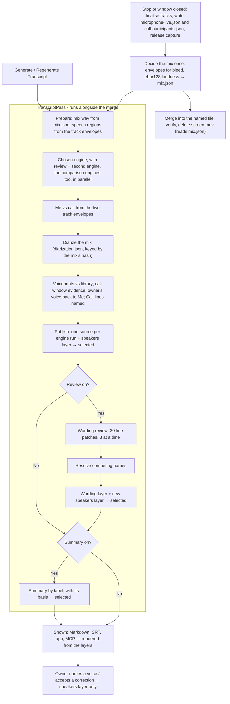

# Recording, transcription and summary

Stopping a recording, or closing its captured window, finalises its three tracks and
frees the recorder. Everything after that runs in a background queue, one recording at
a time, keyed by its folder; the next call can be recorded meanwhile. The app,
`anyrec transcribe`, `anyrec record --transcribe` and the terminal UI all run the same
Kit pass, `TranscriptPass`.

## Stages, in order

1. **Capture ends** (`RecordingSession.finishCapture`). Writes `screen.mov`,
   `system-audio.m4a`, `microphone.m4a`, `microphone-live.json` (when the call could
   hear the microphone) and `call-participants.json` (what the call window showed).
   The recorder is released before anything below starts.
2. **Mix decision** (`MixPlan.decided(for:)`). Decodes both track envelopes (shared,
   and remembered for the rest of the pass), checks bleed, measures each track with
   ffmpeg `ebur128=peak=true` (both at once, and only when the microphone does not
   bleed), and writes `mix.json`, keyed to the tracks' and `microphone-live.json`'s
   size and modification time. A later run reads it instead.
3. **Merge and transcript, side by side** (`RecordingJobs`).
   - **Merge** (`Muxer`): reads `mix.json`, copies the video from `screen.mov` (or, on a
     re-merge, from the merged file) and writes the merged file named from `recording.json`;
     once AVFoundation confirms every frame and the whole mix are there, it is moved into
     place, its name recorded in `recording.json`, and `screen.mov` deleted.
   - **Transcript** (`TranscriptPass`):
     1. *Prepare*: builds `mix.wav` (16 kHz mono, scratch) from the same plan; speech
        regions come from the mix's envelope worked out from the two track envelopes.
     2. *Recognise*: the chosen engine. With review and "Review with a second engine",
        the comparison engines run on the same mix concurrently.
     3. *Attribute*: each line to "Me" or the call from which track was louder.
     4. *Diarize*: FluidAudio over the mix, or `diarization.json` when its SHA-256 of
        the mix matches.
     5. *Identity*: voiceprints against the library; call-window evidence per voice
        (agreement, alias, conflict, fused voice); the owner's own voice given back to
        "Me" where the microphone spoke; "Call" lines named from the window.
     6. *Publish*: one `transcript-<engine>-<UUID>.json` per engine run (never
        rewritten) and a `speakers-<UUID>.json`, selected in `.transcription.json`.
        The transcript is usable from here.
     7. *Review* (opt-in): wording patches in sections, three in flight; then competing
        names resolved. Writes `wording-<UUID>.json` and a new speakers layer, selected
        together. A failure is recorded in the wording layer; the source stays.
     8. *Summary* (opt-in): written from the transcript as it reads now, unnamed
        speakers by label, with the digest and names it was written from, as
        `summary-<…>.json` and `.md`, selected.
4. **Afterwards**. Naming a voice or accepting a speaker correction rewrites the
   speakers layer and nothing else, then re-renders the Markdown, SRT and the summary's
   Markdown. The summary is never dropped; it is marked stale when the words, who said
   them, or a name it used changed, and can be refreshed.

What reads what: Markdown, SRT, the app's transcript and MCP results are all rendered
from the selected source + speakers layer + wording layer (`RecordingTranscript`).
Generations written before layers (`transcript-…`, `voices-…`, `review-…` selected
together) and older recordings without a selection read the same way and are moved
into layers only when the owner changes something.

## Timings

Measured on a 76-minute Slack call (M3 Pro, Parakeet, no review): preparation went
from 230 s to 30 s, the whole transcript from 331 s to 138 s, and a regeneration with
the mix decision and diarization kept from 331 s to 36 s. In the app the merge used to
measure the tracks again (another ~186 s) and ran before the transcript; it now reads
`mix.json` and runs beside it.

## Review and speakers

Settings › Transcription has the engine switches, **Review transcripts with an LLM**,
the review provider, **Review with a second engine** with the engines it runs, and the
Speakers section. Review sends transcript text to the chosen provider; a checked OpenAI
comparison engine uploads audio. Details are in
[transcript-aggregation.md](transcript-aggregation.md) and
[participant-identification.md](participant-identification.md).

## Implementation

[RecordingSession](../Sources/AnyRecKit/Session/RecordingSession.swift) finalises
capture. [RecordingJobs](../Sources/AnyRecBar/RecordingJobs.swift) decides the mix and
runs the merge beside [TranscriptPass](../Sources/AnyRecKit/Session/TranscriptPass.swift).
[MixDecision](../Sources/AnyRecKit/MixDecision.swift) keeps the mix.
[TranscriptionService](../Sources/AnyRecKit/Transcription/TranscriptionService.swift)
prepares audio and recognises speech.
[ParticipantAttribution](../Sources/AnyRecKit/Transcription/ParticipantAttribution.swift)
names voices. [TranscriptStore](../Sources/AnyRecKit/Transcription/TranscriptStore.swift)
and [TranscriptLayers](../Sources/AnyRecKit/Transcription/TranscriptLayers.swift) keep
and render the layers. [SummaryPass](../Sources/AnyRecKit/Session/SummaryPass.swift)
writes the summary.
